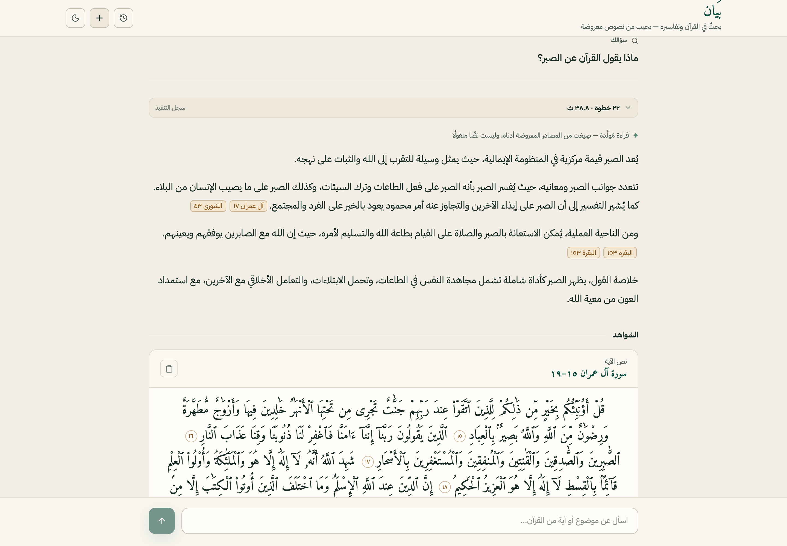
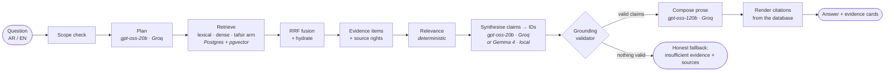
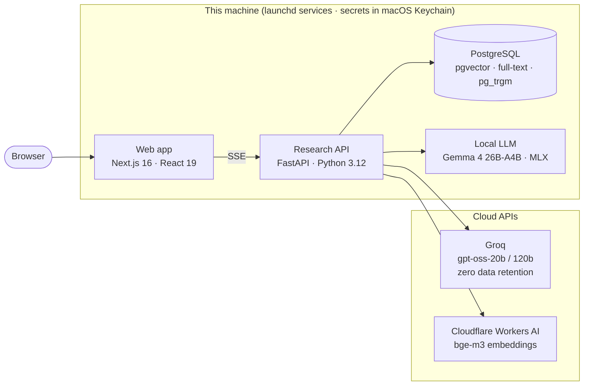

<div align="center">

# بَيان · Bayān

**An evidence-grounded research assistant for the Qur'an and its tafsir. It answers in Arabic or English, and every sentence points to a source shown beside it.**

</div>



Bayān is a working proof of concept of *trustworthy* retrieval-augmented generation for religious
text. Language models help it understand the question and phrase the answer. **Deterministic code
decides what counts as evidence and renders every citation**, so the model has no way to invent a
verse, a verse number, or a tafsir quote.

> 📄 **Two-page technical overview:** [docs/overview/bayan-overview.pdf](docs/overview/bayan-overview.pdf)

---

## Core ideas

| | |
|---|---|
| **The model picks evidence; code writes the citation** | Models return *evidence IDs*, never verse text or references. The verse text, surah name and verse number are fetched from the database by ID. |
| **Every claim is checked** | A `GroundingValidator` rejects unknown IDs. An entailment gate drops any individual sentence that adds ideas absent from its sources, and the rest of a good answer survives. |
| **Honest when evidence is thin** | If nothing survives validation, the reader sees *"insufficient evidence"* and the retrieved sources, instead of a fluent guess. |
| **Rights-aware routing** | Each source carries a policy. Text that may not be sent to a cloud model is processed by a **local** model on the same machine. |
| **Observable** | Every stage emits a trace event. Events stream live to the UI and are stored per turn in Postgres. |

## How a question becomes an answer



1. **Scope check.** Questions outside Qur'an and tafsir research (rulings, hadith, …) stop early,
   with an explanation.
2. **Plan.** A strict-JSON, schema-validated research plan: intent, operations and search queries.
3. **Retrieve.** Three arms:
   - Arabic-normalised full-text + trigram search;
   - dense search over **bge-m3** embeddings (1024-d, HNSW);
   - a tafsir arm that finds verses through their commentary.
4. **Fuse.** Reciprocal Rank Fusion merges the arms by rank, not by raw score, and the top passages
   are hydrated with their canonical text.
5. **Evidence.** Each passage becomes an item with an ID, a canonical pointer and a rights policy.
6. **Synthesise.** The model writes short claims, each citing evidence IDs. When a rights-restricted
   tafsir is in the evidence, this step runs on the local model.
7. **Validate.** Every ID must exist, and Arabic/translation pairs are completed. Unsupported claims
   are removed.
8. **Compose.** A larger model rewrites the *verified* claims into prose. It sees claims and
   reference labels only, never the source text.
9. **Render.** Code draws the citation chips and evidence cards straight from the database.

## Architecture



### Models

| Role | Model | Runs on | Why |
|---|---|---|---|
| Planner | `openai/gpt-oss-20b` | Groq | Fast, reliable strict-JSON plans |
| Synthesis | `openai/gpt-oss-20b` | Groq | Evidence-bound claims; schema compliance over style |
| Synthesis (restricted / fallback) | `gemma-4-26b-a4b-it` (4-bit) | Local, MLX-LM | Restricted tafsir stays on-device; also covers Groq rate limits |
| Composer | `openai/gpt-oss-120b` | Groq | The only reader-facing prose |
| Embeddings | `@cf/baai/bge-m3` | Cloudflare Workers AI | Arabic and English in one vector space |
| Relevance & validation | — | Code | Deterministic and auditable |

### Sources

- **Qur'an (Arabic):** Uthmani script, [Tanzil Project](https://tanzil.net)
- **English translation:** Rowwad Translation Center ([QuranEnc](https://quranenc.com))
- **Tafsir:** *al-Mukhtasar fi al-Tafsir* (Tafsir Center for Quranic Studies), via the
  [Quranic Universal Library](https://qul.tarteel.ai)

> **Rights note.** Redistribution rights for some sources are not yet cleared, so **no source
> corpus is included in this repository**. The ingestion commands download or load them locally.
> This project is a private development POC and is not licensed for production or commercial use
> of those sources.

## Tech stack

| Layer | Tools |
|---|---|
| Frontend | Next.js 16, React 19, Tailwind CSS 4, Zod. Arabic-first RTL UI with English |
| Contracts | FastAPI OpenAPI → `openapi-typescript`; type-checking fails on any request/response drift |
| Backend | FastAPI, Pydantic 2, httpx, psycopg 3; a custom stage orchestrator (no agent framework) |
| Search | PostgreSQL 18, pgvector (HNSW), full-text `tsvector`, `pg_trgm` |
| Local inference | MLX-LM 0.31.3 serving a pinned Gemma 4 snapshot on `127.0.0.1` only |
| Quality | pytest (376 tests), Vitest, Playwright, Ruff |
| Demo tooling | Playwright director + Gemini TTS narration + Whisper audit + ffmpeg (see [`demo/`](demo)) |

## Repository layout

```
src/islamic_research_ai/   Backend: API, workflow stages, retrieval, synthesis, validation, tracing
  providers/               Groq, Cloudflare and local MLX clients
  repositories/            PostgreSQL access (hybrid search, conversations, traces)
  ingestion/               Corpus ingestion CLIs
migrations/                SQL migrations (applied idempotently at API startup)
config/                    Model deployments, source policies, pinned local-model manifest
web/                       Next.js app, unit tests (Vitest) and browser tests (Playwright)
tests/                     Backend tests (pytest)
qa/                        Evaluation harnesses and question sets
scripts/                   Keychain launchers, local Gemma runtime, re-embedding jobs
demo/                      Automated, narrated demo-video pipeline
docs/                      Overview PDF and images
design/                    UI design artboards
```

## Getting started (macOS, Apple silicon)

**Prerequisites:**
- Python 3.12
- Node 24 with pnpm
- PostgreSQL 18 with the `vector` and `pg_trgm` extensions
- a Groq API key and a Cloudflare API token (Workers AI)

1. **Install.**
   ```bash
   python3.12 -m venv .venv
   .venv/bin/python -m pip install -e '.[dev]'
   (cd web && pnpm install --frozen-lockfile)
   ```
2. **Credentials.** Store them in macOS Keychain, never in files. Use account `islamic-research-ai`
   with services `groq-api-key` and `cloudflare-api-token`. Put the non-secret
   `CLOUDFLARE_ACCOUNT_ID` in a local `.env.feasibility` (gitignored; see
   [`.env.feasibility.example`](.env.feasibility.example)). Other settings are listed in
   [`.env.example`](.env.example).
3. **Database and corpus.** Point `DATABASE_URL` at your Postgres, then ingest:
   ```bash
   PROJECT_OWNER_RISK_OVERRIDE_ACK=1 .venv/bin/islamic-research-ingest
   PROJECT_OWNER_RISK_OVERRIDE_ACK=1 .venv/bin/islamic-research-ingest-qul-tafsir
   ```
4. **(Optional) local model.** This is needed for rights-restricted tafsir and Groq fallback.
   ```bash
   .venv/bin/python scripts/download_local_gemma.py
   .venv/bin/python scripts/local_gemma_runtime.py serve
   ```
5. **Run.**
   ```bash
   .venv/bin/python scripts/run_api_with_keychain.py       # API on 127.0.0.1:8000
   cd web && BACKEND_BASE_URL=http://127.0.0.1:8000 pnpm dev   # UI on http://localhost:3000
   ```

## Testing

```bash
.venv/bin/ruff check src tests qa scripts demo
.venv/bin/python -m pytest -q
cd web && pnpm typecheck && pnpm test && pnpm test:e2e
```

## Status

This is a research proof of concept, built and evaluated iteratively. Retrieval and selection
changes are measured on a set of hard, paraphrased questions before they are adopted. For example,
a cross-encoder reranker was measured, made results worse, and was rejected. The deployment is
local-only; nothing is publicly hosted.
